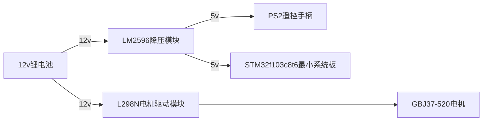

# RMVC 小车示例嵌入式代码

本项目是校内赛小车的示例代码。

小车的制作指南在文章 [guideline.md](./guideline.md) 中。

下面介绍小车相关信息

## 使用物资

-   STM32f103c8t6 最小系统板
-   PS2 遥控手柄
-   L298N 电机驱动模块
-   LM2596 降压模块
-   GBJ37-520 电机

以上物资选择，不是唯一指定，例如PS2手柄可换为蓝牙模块等等。强烈建议自己去选型更好、更廉价的配件！

## 开发环境

-   Keil 5.36，ac5编译器
-   CubeMX
-   C 语言

## 实现功能

-   使用 L298N 驱动 GBJ37-520 直流电机
-   移植了 PS2 遥控手柄淘宝商家提供的现成代码，实现遥控器接受
-   简单的麦克纳姆轮底盘解算

## 电气连线

具体各个模块连线方式，请自行向你购买的淘宝商家要，或者在网上搜索教程



## 目录说明

文件夹下分为三个模块：

```
├── Application/        # 业务代码
│   └── control.c       # 控制程序本体
├── Device/             # 定义一些模块的使用，给Application里的程序提供便用的代码
│   ├── motor.c         # 底盘电机的控制
│   └── ps2.c           # PS2 数据接受程序
├── Core/               # CubeMX自动生成的配置
├── Drivers/            # CubeMX自动复制的HAL库驱动    
├── MDK-ARM/            # Keil 5 工程文件
├── mxproject和rmvc.ioc # CubeMX配置文件
├── guideline.md        # 教程文档
└── README.md           # 项目说明文件
```

## 外设和引脚使用

外设：底盘电机的PWM使用TIM1，舵机使用TIM2，PS2手柄使用SPI1

| motor序号 | PWM引脚 | 逻辑引脚 |
| --------- | ------- | -------- |
| 1         | PA8     | PA8 PA9  |
| 2         | PA9     |          |
| 3         | PA10    |          |
| 4         | PA11    |          |

| ps2手柄 | 引脚 |
| ------- | ---- |
| DATA    | PB12 |
| CMD     | PB13 |
| CS      | PB14 |
| CLK     | PB15 |

## 注意！！！

代码可能不完整，请自己补全。

选型仅供参考，这里选的都是常见型号，如果有更好的鼓励尝试。
