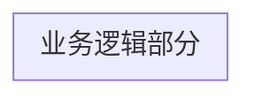

# VGD校内赛嵌入式指南（RMVC Guideline）

在完成这个小车的开发之前，你需要掌握：

1.   C/C++ 编程（主要是C语言，需要基本掌握）
2.   STM32的开发（CubeMX、Keil 的使用）
3.   一些外设的使用：
     -   GPIO
     -   TIM（主要是 PWM）
     -   UART

## 模块选型

作为初学者，我们很难自己画出来整车电路板，所以肯定是用现成模块组装。

GB32-520搭配L258N是常见的电机+驱动组合，由于是学长推荐的所以没考虑太多就选择了这个。不过如果有更便宜的电机肯定更好，同时TB2312也是一个常见的电机驱动。购买电机需要注意电机的减速比等参数，不然买一个减速比超大的电机，最大转速的底盘依旧是乌龟爬。

电机分为直流电机、交流电机、无刷电机等等，直流电机最简单，用在这种地方也最方便，用PWM就可以驱动（这个你会），而其他的需要太大太难的驱动模块或电路（而且贵）所以暂时可以放下。

遥控器选择用PS2手柄（因为网上资料多），他使用SPI通信，虽然我不懂但是商家写好了驱动代码，通过自己看+AI解释，虽然麻烦了一点但也可以完成移植使用。因为不想学SPI了所以直接 copy 过来就可以使用了（虽然不懂原理但是只是想用一个遥控器所以不想学SPI了）

这里用一些蓝牙通信模块其实同样可以实现，他们搭配手机可以用屏幕模拟摇杆，用串口通信（同时也可能便宜一点，吗？）所以也可以考虑。

舵机同样用PWM操控，技术上没有难度。但是要注意舵机分为180舵机和360度舵机两种，其中180度舵机才是控制角度的，另一个是控制速度的。

## 代码编写

这里我们对我们要做的事情进行分析，我们需要完成这样一个框架：

