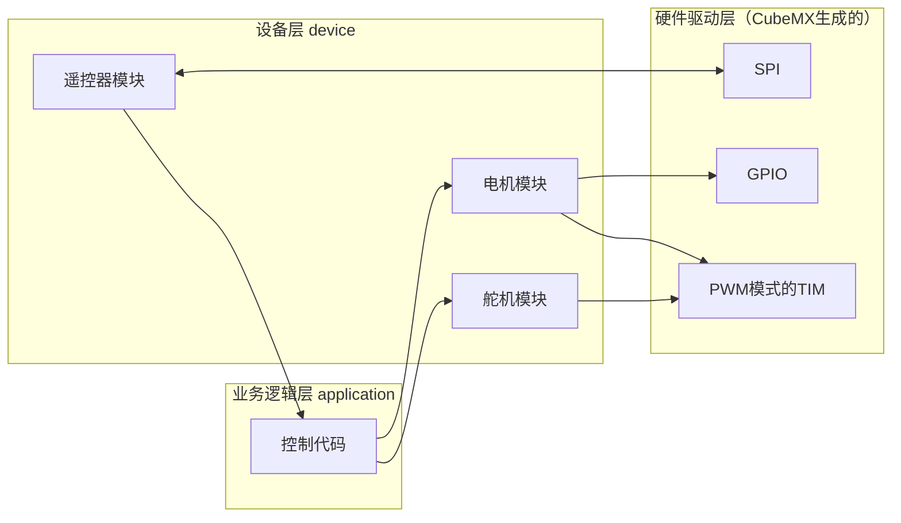
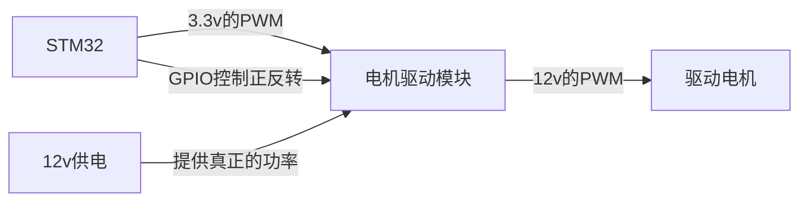
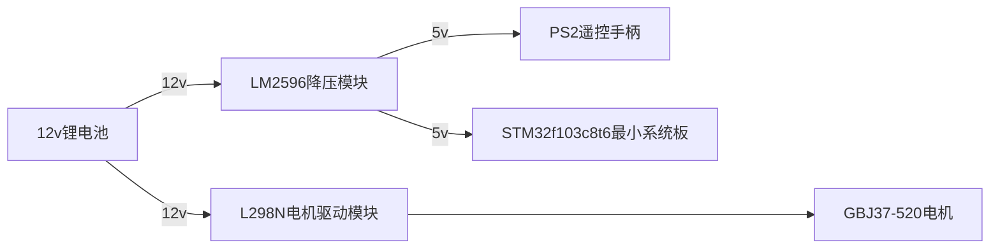
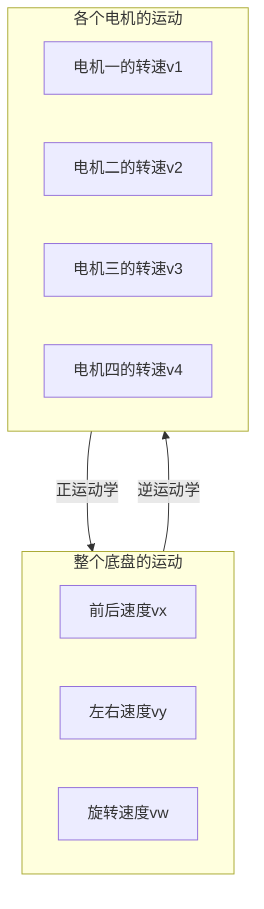
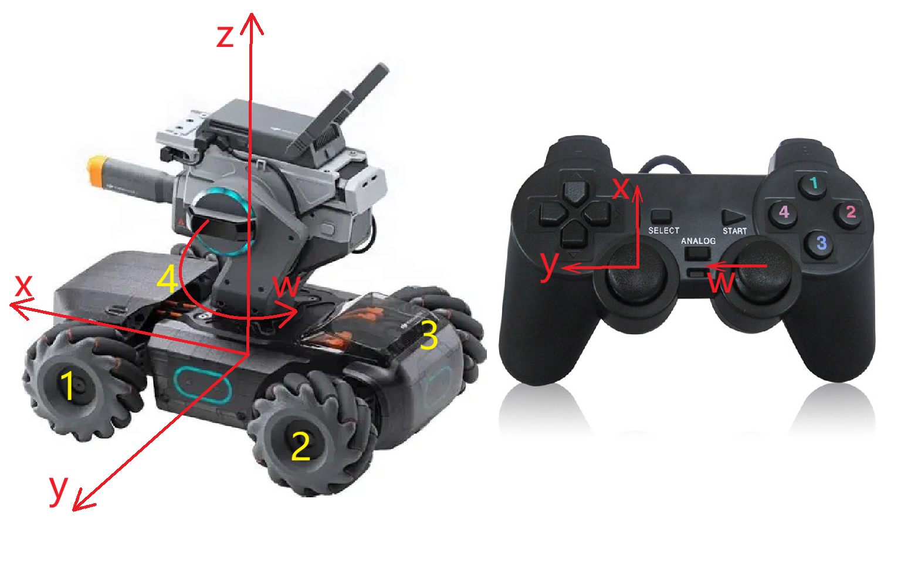

# VGD校内赛嵌入式指南（RMVC Guideline）

在完成这个小车的开发之前，你需要掌握：

1.   C/C++ 编程（主要是C语言，需要基本掌握）
2.   STM32的开发（CubeMX、Keil 的使用）
3.   一些外设的使用：
     -   GPIO
     -   TIM（主要是 PWM）
     -   UART

## 程序设计

这里我们对我们要做的事情进行分析，他大概是这样的：



因为主要的业务代码，因为main.c放了好多cubemx生成的东西，阅读困难，所以我在main函数里调用了一个函数，函数定义放在了application文件夹下的control.c中，他包括了整个具体的小车工作逻辑。

各个模块我放在了device（设备）文件夹中，包括舵机、电机和遥控器的。他们会 include CubeMX在Core中生成的外设代码，然后把pwm、gpio输出等等包装为一些设备模块，例如motor1_set()，你输入一个占空比就可以控制这个电机，或输入角度控制舵机。

其他底层代码是cubemx生成的，我们尽量不改动他们。

## 模块使用

作为初学者，我们很难自己画出来整车电路板，所以肯定是用现成模块组装

### 电机

通过呼吸灯的实验，你知道了PWM可以改变占空比，模拟电压变化，从而调整LED小灯的亮度/功率。同理，我们对电机输出PWM，也可以调整电机的转动。

但是这里有几个问题：STM32直接输出的PWM可以连到电机上吗？不可以。

-   电机的电压最大值是12v，单片机输出不了
-   电机的功率很大，单片机带不动（不可以作为功率输出）
-   PWM的占空比从0到100%，无法表示电机正反转是怎么样

所以有了电机驱动模块：STM32的PWM作为调节信号，用GPIO控制正反转，通过驱动模块后会放大为12v的驱动电压



这种电机驱动模块有很多，例如常见的：

-   [TB6612电机驱动模块（STM32） - 知乎](https://zhuanlan.zhihu.com/p/24671600433)
-   [L298N 电机驱动板 - 详细介绍 - 知乎](https://zhuanlan.zhihu.com/p/346930154)

这两个模块都是一次可以控制两个电机，连线方式搜索浏览器、问你买的淘宝商家都可以找到信息。（如下是L298N的）


GB32-520电机也是常见的型号，所以本项目用了这个。购买电机需要注意电机的**减速比**等参数，不然买一个减速比超大的电机，占空比给100%也是龟速。

电机其实还有很多种，如直流电机、交流电机、无刷电机等等，可以自行了解。这个电机是直流减速电机。

这里其实有一个忽略的点，我们控制的是电机的电压，实际他对应的是电机的位置、速度还是加速度？实际上都不是，其实是电流和加速度（也就是力）成正比。这里我们实际没有对任何物理量做控制，

### 舵机控制

舵机同样用PWM操控，技术上没有难度。但是要注意舵机分为180舵机和360度舵机两种，其中180度舵机才是控制角度的，另一个是控制速度的。

舵机有三根线，其中 GND 5V 是供电，PWM是信号。给舵机发送特定频率和占空比的 PWM 信号，他就会自己转到一定角度。

具体控制代码网上随便找找就可以了。~~我不想找一个绝妙的代码了，但这里其实写得下~~

### 遥控器

这里用的PS2手柄做遥控器，走SPI通信。虽然不懂SPI，但商家有现成驱动，靠看代码和AI解释就能移植使用。

PS2可能有点贵，同时容易出现bug。用一些用串口通信的蓝牙模块其实也可以实现遥控，他们搭配手机蓝牙可以用屏幕模拟摇杆。

## 供电

下图在readme中也有，



## 麦克纳姆轮底盘！

我们完成了所有用到的device的代码，现在需要用这些设备完成运动了。

首先参考链接（建议严肃阅读）：

-   [可以前后左右平移的神器轮子 来看看是怎么做到的-麦克纳姆轮平移原理（神秘R标）](https://www.bilibili.com/video/BV19W411h7if/)
-   [麦克纳姆轮系运动学模型解算与分析_麦克纳姆轮运动学解算-CSDN博客](https://blog.csdn.net/m0_55933541/article/details/134040714)

麦克纳姆轮，as known as 麦轮、Mecanum wheel（Mecanum 就是发明轮子的公司的名字）。他能实现全向运动（xy平移和旋转）。

同样能够实现全向运动的还有全向轮，他的底盘可以是3轮或4轮，而麦轮底盘必须是4轮的。这里我们用麦轮底盘举例，实际上两者几乎一样，原理相同。

麦轮上有很多辊子，你旋转轮子时，实际上那些45°的倾斜的辊子受地面的摩擦力也是45°的，所以四个轮子给底盘的力也是四个方向45度的，通过力/速度矢量的合成分解就可以实现全向运动了。

**具体的原理请看相关资料学习（如上面链接或你自己找），你只要知道了麦轮/全向轮的原理很容易写出来能正确的运动，完全可以自学**。但下面我想引入一下运动学，认识我们到底在做什么：

## 运动学解算

什么是运动学：分析运动（不分析力），也就是分析位置/速度/加速度。运动学分两种过程：

-   逆运动学：我想让整个底盘运动，那么各个轮子该怎么动？
-   正运动学：我知道各个轮子的运动情况，那么整个底盘正在怎么运动？



我们一般右手坐标系；x为前、y为左、z为上；在 xOy 平面的旋转 w，按z轴从上到下看逆时针为正（左图红色坐标系）

四个轮子的标号按照 xOy 平面的象限标号（左图黄色数字）

这里我们可以让遥控器摇杆作为整个底盘的速度：左摇杆对应平移，右摇杆对应旋转（右图）



具体的运动学解算可以多搜索一下，网上有很多（可能他们的坐标系和我用的不一样，但是原理是一样的），如：

-   [麦克纳姆轮运动学解算 | 范子琦的博客](https://www.robotsfan.com/posts/b6e9d4e.html)

不过可见他们的解算是很复杂的。正解需要知道各个轮子速度，而如果我们想要知道电机转速，需要有编码器才行。同时逆运动学也输出的是轮子转速。但我们用PWM控制电机，并不能指定电机转速，所以这里简陋一点也是可以用的，我们可以当作占空比输出：

```c
#define Kw 只是一个系数

float vx, vy, vw;
float v1, v2, v3, v4;

// 逆运动学
v1 = ( vx + vy + Kw * vw);
v2 = ( vx - vy + Kw * vw);
v3 = (-vx - vy + Kw * vw);
v4 = (-vx + vy + Kw * vw);
```

同时要注意，底盘电机的PWM输出的是占空比。所以代码里是把所有速度缩放到 -1~1 区间里就得到了占空比。

其实上面我们说知道了麦轮原理，很容易写出来能正确运动的代码，就是指这里的正负号怎样的。你可以很容易的定性的控制底盘，但是他的数值大小没有意义，他不是速度也不是力。如果我们想要定性的分析，就需要具体分析

>   如果你想尝试完整准确的底盘解算，可以尝试用TIM的编码器功能搭配有**编码器**的电机使用，测量电机的转速。并测量底盘的尺寸，就可以计算出底盘解算了
>
>   附完全版大概代码如下：
>
>   ```c
>   #define WHEEL_RADIUS // 轮半径
>   #define X_WIDTH      // 前后轮间距
>   #define Y_WIDTH      // 轮间距
>   
>   float vx, vy, vw;
>   float v1, v2, v3, v4;
>   
>   // 正运动学 FK (forward kinematics)
>   vx = (v1 + v2 - v3 - v4) * (WHEEL_RADIUS / 4);
>   vy = (v1 - v2 - v3 + v4) * (WHEEL_RADIUS / 4);
>   vw = (v1 + v2 + v3 + v4) * (WHEEL_RADIUS / (4 * (X_WIDTH + Y_WIDTH)));
>   
>   // 逆运动学 IK (inverse kinematics)
>   v1 = ( vx + vy + (X_WIDTH + Y_WIDTH) * vw) / WHEEL_RADIUS;
>   v2 = ( vx - vy + (X_WIDTH + Y_WIDTH) * vw) / WHEEL_RADIUS;
>   v3 = (-vx - vy + (X_WIDTH + Y_WIDTH) * vw) / WHEEL_RADIUS;
>   v4 = (-vx + vy + (X_WIDTH + Y_WIDTH) * vw) / WHEEL_RADIUS;
>   ```

